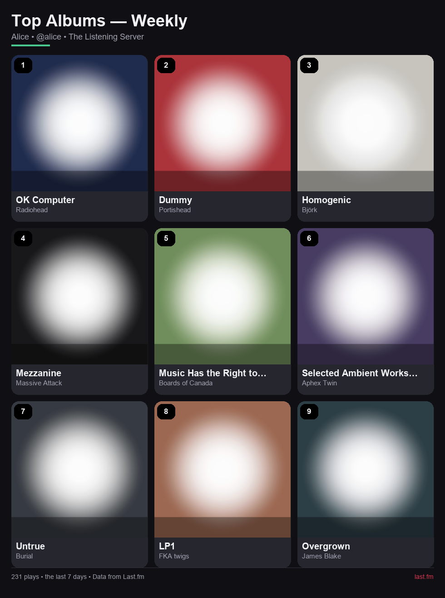
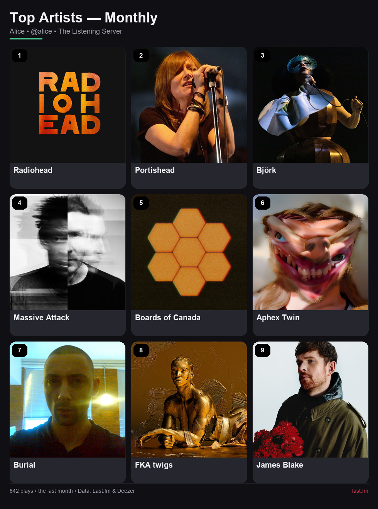

# Last.fm Summary — a Red-DiscordBot cog

Turn a Discord server's Last.fm listeners into clean, automatically posted
**top artists or top albums grids**. Every linked member gets their own chart.

Members link their Last.fm usernames once. At the cadence you choose, the bot
fetches each linked member's top chart for the matching time window and posts
that member's own image with covers, names and ranks.



## Features

- **A chart for every member** - each linked Last.fm account gets its own grid,
  posted separately with that member's name and profile.
- **Artists or albums** - album tiles show the album and artist name.
- **Artist portraits** - when Last.fm returns its placeholder artist image, the
  cog looks up a portrait on Deezer. If neither source has an image, a generated
  initials tile is used.

  

- **Configurable cadence** — weekly, monthly, quarterly, half-yearly or yearly.
  The cadence is also the chart window (`weekly` uses Last.fm's 7-day chart).
- **Configurable grid** — square grids from 2×2 to 8×8 (3×3 by default).
- **Timezone-aware scheduling** — set any IANA timezone and a local posting time.
- **Robust rendering** — cover art is cached; missing or placeholder art becomes
  a clean generated tile, so the grid never has holes.
- **Image posts** - one PNG attachment plus an embed per member. One member's
  failed fetch does not stop the others.
- **Slash and text commands** — hybrid commands work with `[p]` and `/` after
  `[p]slash sync`.
- **Privacy-aware** — per-guild registrations, `unregister`, and Red `mydata`
  integration.

## Requirements

- Red-DiscordBot 3.5.0 or newer (Python 3.9–3.11, as supported by Red)
- A [Last.fm API key](https://www.last.fm/api/account/create) (free)
- Deezer artist portraits need no API key or account.
- `Pillow` and `tzdata` are installed automatically from the cog's
  `info.json` requirements.

## Installation

### From a Git repository

Add this repository to Red and install the cog:

```
[p]repo add lastfm-summary <repository-url>
[p]cog install lastfm-summary lastfmsummary
[p]load lastfmsummary
```

### Local checkout (development)

The fastest way to test unreleased changes is Red's cog path support:

1. Install the cog's Python dependencies into **Red's** Python environment
   (use the same interpreter/venv that runs Red):

   ```
   <red-venv>\Scripts\python.exe -m pip install "Pillow>=10.1" tzdata
   ```

   On Linux/macOS use `<red-venv>/bin/python`.

2. In Discord, add the parent folder that contains the `lastfmsummary` package
   (not the package folder itself):

   ```
   [p]addpath D:\Code\cog-lastfm-summary
   ```

3. Load it as the bot owner:

   ```
   [p]load lastfmsummary
   ```

After editing the code, reload it:

```
[p]reload lastfmsummary
```

`[p]cogs` lists discovered packages if the load command cannot find it. Red's
`addpath` changes take effect immediately and do not require a restart.

### Slash commands

Hybrid commands work as `[p]` text commands immediately. To enable the slash
forms:

```
[p]slash enablecog LastFMSummary
[p]slash sync
```

Run `[p]slash list` first if the cog name differs in your installation. Run
`[p]slash sync` in the test guild while iterating to avoid waiting for global
command propagation.

## Setup

1. **Bot owner — API key.** Create a Last.fm API account and set the key once:

   ```
   [p]lastfmset api_key <your-api-key>
   ```

   Alternatively set the `LASTFM_API_KEY` environment variable before starting
   Red. The environment variable is used when no key is stored.

2. **Server admin — output channel:**

   ```
   [p]lastfmset channel #listening
   ```

3. **Server admin — schedule and look:**

   ```
   [p]lastfmset period monthly
   [p]lastfmset time 09:00
   [p]lastfmset timezone Europe/Berlin
   [p]lastfmset source artists
   [p]lastfmset grid 3
   [p]lastfmset day 1
   ```

4. **Members — link accounts:**

   ```
   [p]lastfm register your_lastfm_username
   ```

5. **Server admin — enable and preview:**

   ```
   [p]lastfmset preview
   [p]lastfmset enable
   ```

   `preview` posts one chart per linked member; use `[p]lastfmset preview @member`
   to check a single member first. On a busy server, preview before enabling.

The bot needs **Send Messages**, **Attach Files** and **Embed Links** in the
configured channel.

## Commands

### Members

| Command | Description |
| --- | --- |
| `[p]lastfm` | Show your link status and the server's summary settings. |
| `[p]lastfm register <username>` | Validate and link a Last.fm username (also accepts a profile URL). |
| `[p]lastfm unregister` | Remove your link from this server. |
| `[p]lastfm profile [member]` | Show a member's linked account. |
| `[p]lastfm members` | List linked members. |
| `[p]lastfm status` | Show the server's schedule, grid and member count. |

`lastfm` also works as `lfm`.

### Server admins (`manage_guild`)

| Command | Description |
| --- | --- |
| `[p]lastfmset channel [#channel\|none]` | Set the output channel, or clear it and disable posting. With no argument, uses the current channel. |
| `[p]lastfmset period <weekly\|monthly\|quarterly\|half-yearly\|yearly>` | Set cadence and chart window. |
| `[p]lastfmset source <artists\|albums>` | Choose what the grid shows. |
| `[p]lastfmset grid <2-8>` | Set the square grid size. |
| `[p]lastfmset time <HH:MM>` | Set the local posting time (24-hour). |
| `[p]lastfmset timezone <IANA>` | Set the scheduling timezone, e.g. `America/New_York`. |
| `[p]lastfmset day <monday..sunday\|1-31>` | Anchor day: weekday for weekly, day of month otherwise. Days beyond a month's length are clamped. |
| `[p]lastfmset enable` | Enable automatic posting. |
| `[p]lastfmset disable` | Disable automatic posting. |
| `[p]lastfmset preview [member]` | Post charts now for one member or for every linked member. Does not change the schedule. |
| `[p]lastfmset status` | Show the full configuration and last error. |
| `[p]lastfmset api_key <key>` | Bot owner only. Set the Last.fm API key. |

`lastfmset` also works as `lfmset`.

## Schedule semantics

| Period | Last.fm window | Default anchor |
| --- | --- | --- |
| `weekly` | 7 days | Monday 09:00 |
| `monthly` | 1 month | 1st at 09:00 |
| `quarterly` | 3 months | 1 January/April/July/October at 09:00 |
| `half-yearly` | 6 months | 1 January/July at 09:00 |
| `yearly` | 12 months | 1 January at 09:00 |

All defaults use UTC until an admin sets another timezone. The scheduler checks
every 30 seconds and persists the next run in Red's config, so restarts and cog
reloads do not lose the schedule. If a run is more than six hours overdue (for
example after a long outage), it is skipped instead of posted late. Runs missed
while the bot is offline are not backfilled.

## How the charts work

For every linked member, the cog requests that member's top artists or albums
for the selected window (up to 50–200 entries depending on grid size). Each
member's list is rendered as its own grid:

- The grid is filled from rank 1 down to N×N, using Last.fm's chart order.
- **Artists** show the artist name; **albums** show the album name and artist.
- Artist images are resolved in this order: Last.fm image → Deezer portrait →
  generated initials tile. Deezer lookups are cached on disk for 30 days.
- The embed and image caption identify the member, their Last.fm handle, and
  the server.
- `plays` in the footer counts all fetched entries for that member, not just
  the visible tiles.

If a member's profile is private, deleted, or temporarily unavailable, the other
members still get their charts. The failed member is recorded for
`lastfmset status` and reported by `lastfmset preview`. If nobody can be fetched,
no images are posted and the failure is recorded.

## Data and privacy

Per server, the cog stores:

- Discord user ID
- Last.fm username
- registration timestamp

No scrobbling or Last.fm authentication is performed, and the API key is only
used for public read endpoints. The Last.fm API key is stored globally and is
never shown in full.

When an artist has no usable Last.fm image, only the **artist name** is sent to
Deezer's public search API. No Discord user data, Last.fm username, or API key
is sent to Deezer. Resolved image URLs are cached under the cog's data folder.

Members remove their own link with `[p]lastfm unregister` or Red's
`[p]mydata` commands. Deleting the cog does not automatically delete stored
data; use Red's data deletion commands first if needed.

## Troubleshooting

| Symptom | Fix |
| --- | --- |
| `No Last.fm API key is configured` | Bot owner runs `[p]lastfmset api_key <key>` or sets `LASTFM_API_KEY`. |
| `Last.fm rejected the configured API key` | The key is invalid or suspended; the bot owner must replace it. |
| `Last.fm has no user named ...` | Check the username or profile URL. |
| `The lastfm user ... is already linked` | Each Last.fm account can only be linked once per server. |
| Summary skips a run | Verify `[p]lastfmset status`: channel still exists, bot can attach files, and members are linked. |
| One member's chart is missing | That profile may be private, renamed, or temporarily unavailable. Check `[p]lastfmset status` for the recorded failure. |
| Images have letter tiles instead of covers | Last.fm returned placeholder art and Deezer had no confident match. This is normal for obscure artists. |
| Artist portraits are missing | Deezer returned no confident match, or the lookup failed; the cog falls back to a generated tile. |
| Times look wrong | Set the server's timezone with `[p]lastfmset timezone`; the schedule uses local wall-clock time. |

## Development

Use Python 3.9–3.11 (the versions Red supports):

```bash
python -m venv .venv
.venv/Scripts/activate        # Windows
# or: source .venv/bin/activate
pip install -e ".[dev]"
pytest -q
ruff check .
ruff format --check .
```

Pure tests (scheduling, API parsing, rendering) do not need Discord or network
access. `tests/test_cog.py` is skipped unless Red is importable. To run the full
suite locally, install Red into the same virtual environment:

```bash
pip install "Red-DiscordBot @ git+https://github.com/Cog-Creators/Red-DiscordBot.git@V3/develop"
pytest -q
```

Current expected result: 84 tests pass with Red installed, or 51 pass and 1
skipped without it.

### Manual smoke test

With Red running and the cog loaded:

1. Bot owner: `[p]lastfmset api_key <key>`
2. Admin: `[p]lastfmset channel #your-test-channel`
3. Admin: `[p]lastfmset timezone Europe/Berlin`
4. Member: `[p]lastfm register <lastfm-username>`
5. Admin: `[p]lastfmset preview @member` to post one chart immediately.
6. Check `[p]lastfmset status` for the schedule and any recorded error, then
   run `[p]lastfmset enable` when the preview looks right.

`preview` does not change the schedule, so it is safe to repeat while testing.

## Credits

- Charts and artwork: [Last.fm](https://www.last.fm/)
- Artist portraits: [Deezer](https://www.deezer.com/)
- Framework: [Red-DiscordBot](https://github.com/Cog-Creators/Red-DiscordBot)
- Not affiliated with Last.fm or Discord.
